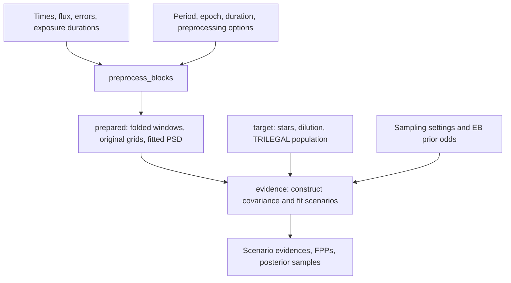

# FPP from an existing or injected light curve

Use this guide when you already have flux measurements and want to run
Pentaceratops without downloading the light curve again. The array entry point
is `preprocess_blocks()`. It produces the photometry and saved noise-model state
needed by `evidence(prepared, target=target, ...)`.

There are two separate inputs to inference:

- `prepared`: the light curve, ephemeris, and noise-model preparation.
- `target`: the stellar field, aperture dilution, and background population.

The injection's physical parameters describe what was put into the data.
Pentaceratops fits its own scenario parameters; it does not need to be told that
the injected signal is an EB or given its true mass ratio and eccentricity.

## Where the inputs enter



`preprocess_blocks()` bins the supplied observations, fits a Fourier Gaussian
process (FGP) and its power spectral density (PSD), and saves the result.
`evidence()` uses that saved state to build the selected likelihood. It does
not repeat the PSD fit or query a catalog.

## 1. Photometry: one block per segment

Supply a list of dictionaries. Each dictionary represents one quarter, sector,
or other observation segment with its own fitted variability model.

| Block key | Type and shape | Required value | How it is used |
| --- | --- | --- | --- |
| `time` | float array, shape `(n,)` | Original timestamps in days, finite and strictly increasing within a block | Defines observations, transit cycles, even/odd assignments, and the regular grid used for PSD estimation |
| `flux` | float array, shape `(n,)` | Normalized aperture flux, with the baseline near one | Supplies the observations for detrending and scenario comparisons |
| `error` | float array, shape `(n,)` | Measurement uncertainties in the same flux units | Sets bin weights and contributes to noise estimation; do not include stellar-variability uncertainty a second time |
| `exposure_seconds` | float | Positive exposure duration in seconds | Sets the lower bound on the common bin width and the approximate exposure response |
| `segment` | int | Unique label | Identifies the saved segment and its noise-model state; a synthetic segment can use `1` |

Here `n` is the number of observations in that segment; the three arrays of a
block have the same length, and different blocks may have different lengths.

A complete, valid input built from scratch looks like this. It makes two
27-day sectors of 10-minute data with a box-shaped transit, and runs as written:

```python
import numpy as np

rng = np.random.default_rng(1)
period, t0, duration_hours, depth = 3.5, 1684.0, 2.4, 2e-3   # days, BTJD, hours, fraction

blocks = []
for segment, start in ((1, 1683.4), (2, 1711.4)):
    time = start + np.arange(3900) * 10 / 1440                # BTJD, days
    flux = 1 + 4e-4 * rng.standard_normal(time.size)          # normalized aperture flux
    phase = (time - t0 + period / 2) % period - period / 2
    flux[np.abs(phase) < duration_hours / 48] -= depth        # the transit
    error = np.full(time.size, 4e-4)                          # same units as flux
    blocks.append(dict(time=time, flux=flux, error=error,
                       exposure_seconds=600.0, segment=segment))
```

Printing the type of each entry of `blocks[0]` gives:

```text
time              ndarray float64 (3900,)
flux              ndarray float64 (3900,)
error             ndarray float64 (3900,)
exposure_seconds  float
segment           int
```

For this candidate-preparation route, `time` must be mission-relative: BKJD
(`BJD - 2454833`) for Kepler, or BTJD (`BJD - 2457000`) for TESS. The candidate
epoch below is supplied in full BJD. Use matching time systems, normally BJD
TDB, for both. For synthetic timestamps, choose the epoch in the same coordinate
system and apply the same offset.

Keep real gaps. Unusable flux/error samples are omitted during binning; retained
errors must be finite and positive. Do not fill gaps with artificial flat flux,
repeat observations between blocks, or replace timestamps with folded phases.
Resolve overlapping segment grids before inference. The common bin width is
the larger of the requested `bin_minutes` and the longest supplied exposure.
It becomes an approximate rectangular exposure duration for the folded models.

### Flux normalization and dilution

The array route assumes aperture-normalized flux and errors. It does not inspect
FITS headers or restore a crowding correction for you. For normalized PDCSAP
data, use the actual product's crowding factor to restore the aperture frame
once, before injection/preprocessing. See [flux normalization](https://github.com/dkn16/pentaceratops/blob/main/src/pentaceratops/preprocessing/flux.py).
Already restored aperture data should not be corrected again.

For an isolated synthetic source, `fluxratio=1` is consistent with a model
normalized to that source's total light. In a crowded aperture, inject the
appropriately diluted signal and supply matching stellar flux fractions.
The internal light of the two EB components and dilution by other aperture
sources are separate quantities. The injection's requested SNR is not a
replacement for the flux-error array or noise covariance.

## 2. Candidate ephemeris

Construct `pentaceratops.preprocessing.catalog.Candidate` with these fields:

| Field | Type | Units / requirement | How it is used |
| --- | --- | --- | --- |
| `mission` | str | `"Kepler"` or `"TESS"` for this example | Sets the time zero; the matching target mission also selects the limb-darkening bandpass |
| `host_id` | int | Positive, matching `target.ID` and the first stellar row | Checks that photometry and stellar field belong together |
| `identifier` | str | Descriptive, e.g. `"injection-001"` | Labels the preparation; it need not be a catalog planet identifier |
| `period_days` | float | Positive candidate period in days | Sets folding, transit-cycle labels, and the orbital period used by the scenarios |
| `epoch_bjd` | float | Primary-event reference epoch in full BJD | Centers the transit windows and folding operator |
| `duration_hours` | float | Positive event duration in hours | Defines protected training windows and the extracted windows; scenario model durations are fitted, not fixed to this value |
| `depth_ppm` | float or `None` | Optional depth in parts per million | Records a depth estimate; setting it does not automatically calculate dilution or update a supplied stellar field |

For the synthetic light curve above:

```python
from pentaceratops.preprocessing.catalog import Candidate

candidate = Candidate(
    mission="TESS", host_id=123456789, identifier="example-01",
    period_days=period,
    epoch_bjd=2457000.0 + t0,          # full BJD = BTJD + 2457000
    duration_hours=duration_hours,
    depth_ppm=1e6 * depth,
)
```

Passing `blocks` and `candidate` to `preprocess_blocks` returns a dictionary
with three entries: `windows` (the folded even, odd, secondary and combined
primary windows as arrays `time_*`, `flux_*`, `err_*`), `segments` (one record
per block with its grid, masks and fitted variability), and `stream` (the
detrended observations of all blocks joined in time order).

Use the period being tested by the detection/validation experiment. If a binary
is detected at half its physical orbital period, supply that detected period;
the `EBx2P` families then model an orbit twice as long. Do not replace the
candidate period with the true binary period just because it is known from
the injection. Likewise, specify an epoch and duration appropriate to the
detected events. Injection truth can be recorded separately for evaluation.

Identifiers and segment labels can be chosen freely in a fully synthetic test.
Timing, exposure durations, flux scaling, and stellar properties define the
experiment and must be consistent with its data.

## 3. Stellar field and background population

Supply an object with `ID`, `mission`, `stars`, and `trilegal_fname`, as in the
example below. `stars` is a pandas table with the target first, followed by
nearby sources. All IDs must be unique positive integers.

| Column / input | Type | Meaning | Where it enters |
| --- | --- | --- | --- |
| `ID` | int | Catalogue identifier (TIC or KIC), unique per row | Labels the host of each scenario; the first row must be the target |
| `mass`, `rad` | float | Stellar mass and radius in solar units | Physical eclipse/transit models and stellar relations |
| `Teff` | float | Effective temperature in kelvin | Limb darkening and stellar-model inputs |
| `plx` | float | Parallax in milliarcseconds | Companion/background scenario calculations |
| `Tmag`, `Jmag`, `Hmag`, `Kmag` | float | Adopted apparent magnitudes; `Tmag` is the column name required by the current interface, including Kepler fields | Photometric constraints and companion/background scenarios |
| `fluxratio` | float in `(0, 1]` | Each source's fraction of the total aperture light | Dilutes that source's modeled signal into the observed flux frame |
| `tdepth` | float | Required fractional eclipse depth on that source | A positive value makes the host eligible for scenario fitting; zero excludes it |
| `trilegal_fname` | path | A prepared TRILEGAL population for this sky field | Supplies background-star scenarios |

`stars` has one row per source in or near the aperture. The first rows of a
real field (TOI-700) look like this; the target comes first, the next two rows
are neighbours faint enough in the aperture that only a deep eclipse on them
could produce the signal, and the last two cannot produce it at all:

```text
       ID   mass    rad   Teff     plx    Tmag   Jmag   Hmag   Kmag  tdepth  fluxratio
150428135 0.4133 0.4195 3494.0 32.0980 10.9102  9.469  8.893  8.634  0.0007     0.9880
736940566 0.8000 0.6706 4895.0  0.0552 18.1912    NaN    NaN    NaN  0.5781     0.0011
150428138 1.0200 0.8908 5717.0  0.2297 17.0941 16.355 16.166 15.374  0.2129     0.0031
736940567 1.0000 1.0000 4710.0  0.6131 19.8117    NaN    NaN    NaN  0.0000     0.0002
736940542 1.0000 1.0000 5777.0 -0.1131 20.3420    NaN    NaN    NaN  0.0000     0.0001
```

Extra columns, such as `ra` and `dec`, are allowed and ignored by `evidence`.

Eligible hosts need finite, positive mass, radius, and temperature, a finite
`Tmag`, and `0 < fluxratio <= 1`. The target also needs finite parallax and
J/H/K magnitudes. Resolved neighbors may have missing parallax/J/H/K because
their nearby-source scenarios do not use these values.

If the aperture depth is `delta` and a source contributes fraction `f`, the
required host depth is `delta / f`. Under the standard depth-eligibility rule,
a value above one makes that source ineligible. For a new injection, update
this eligibility using its aperture depth and preserve any independently
justified follow-up exclusions. Do not reuse the old candidate's `tdepth`
values without checking them. The supplied field is not recalculated by
`evidence()`; setting `Candidate.depth_ppm` does not change it either.

For injections into real stars, reuse their adopted stellar inputs and
appropriate population. Choosing a fictitious field defines a synthetic
experiment; its FPP is conditional on those assumptions. A placeholder or
empty TRILEGAL file is not a valid all-scenario input. The current `evidence()`
wrapper requires a population file even when selecting a scenario subset.

See [target setup](../target_setup.md) for acquiring or reloading field
inputs. `prepare_target()` currently constructs new fields from original TESS
science FITS files and their apertures. An array-only bundle has no such
products: use an adopted field rather than inventing FITS paths or download
metadata. A saved field can be loaded with `load_target()`, but its depth
eligibility must still match the new signal.

## 4. Example: supplied Kepler arrays to a complete FPP

Install the package in your Python environment. This example makes no catalog
queries or downloads, but preprocessing and inference still require computation.
Use a compute allocation for a long light curve or a campaign.

Prepare these three files relative to your working directory:

- `input_lightcurve.npz`: arrays `time`, `flux`, `flux_err`; scalar values
  `period_days`, `t0_relative_days`, `duration_hours`, `exposure_seconds`, and
  `depth_aperture`. Here `time` and `t0_relative_days` are BKJD and
  `depth_aperture` is a dimensionless aperture depth, e.g. `0.001` for 1000 ppm.
  The file represents one segment. You may instead supply the same values
  directly from memory.
- `stars.csv`: the adopted field with the columns above and eligibility
  appropriate to this injection.
- `trilegal.csv`: the corresponding background population in the format
  consumed by Pentaceratops; it is not an arbitrary stellar-table CSV.

```python
from dataclasses import asdict
from types import SimpleNamespace

import numpy as np
import pandas as pd

from pentaceratops import RunResult
from pentaceratops.evidence import evidence
from pentaceratops.preprocessing.catalog import Candidate
from pentaceratops.preprocessing.candidate import (
    PreparationOptions, preprocess_blocks,
)

stars = pd.read_csv("stars.csv")
target = SimpleNamespace(
    ID=int(stars.iloc[0]["ID"]),
    mission="Kepler",
    stars=stars,
    trilegal_fname="trilegal.csv",
)

with np.load("input_lightcurve.npz", allow_pickle=False) as data:
    depth = float(data["depth_aperture"])
    candidate = Candidate(
        mission=target.mission,
        host_id=target.ID,
        identifier="injection-001",
        period_days=float(data["period_days"]),
        epoch_bjd=2454833.0 + float(data["t0_relative_days"]),
        duration_hours=float(data["duration_hours"]),
        depth_ppm=1e6 * depth,
    )
    blocks = [dict(
        time=data["time"].copy(),
        flux=data["flux"].copy(),
        error=data["flux_err"].copy(),
        exposure_seconds=float(data["exposure_seconds"]),
        segment=1,
    )]

# Explicit Kepler binning choice; adjust for the data and transit duration.
options = PreparationOptions(bin_minutes=30.0)
output, diagnostics = preprocess_blocks(blocks, candidate, options=options)
output["windows"]["transit_depth"] = depth  # Record the aperture depth.

prepared = RunResult(output, metadata=dict(
    artifact="candidate_preparation",
    likelihood_ready=False,
    settings=dict(
        candidate=asdict(candidate),
        options=asdict(options),
        input_source="supplied_arrays",
    ),
    diagnostics=diagnostics,
))

# Optional: save once and reload with RunResult.load("prepared.npz").
prepared.save("prepared.npz")

results = evidence(
    prepared, target=target, likelihood="fourier", eb_eta=0.1,
)
print(results.output[["ID", "scenario", "lnBF", "prob"]])
print("FPP:", results.output.attrs["FPP"])
print("EB-only probability:", results.output.attrs["FPP_EB"])
results.save("results_fourier.npz")
```

Use `likelihood="real"` for the subtracted likelihood. The same `prepared`
object supports both calls; no second PSD fit is needed. Saved result paths
must be new because `RunResult.save()` does not overwrite existing files.

For TESS, use `mission="TESS"`, supply BTJD arrays, and change the epoch offset
to `2457000.0`. A 10-minute binning choice matches the default TESS example.
For multiple segments, provide one dictionary per segment with unique labels;
keep their timestamps on one common mission-relative timeline.

The minimal required metadata is `artifact="candidate_preparation"` together
with `settings["candidate"]` and `settings["options"]`. The `output` is the
actual result of `preprocess_blocks()`, not a fabricated dictionary of empty
arrays. It contains the fitted PSD, masks, normalization, and original grids
that inference validates and uses. `likelihood_ready=False` describes the
remaining covariance-construction step; it does not prevent `evidence()` from
using the bundle. Record the injection seed, generator settings, and truth
parameters in additional metadata if needed for later evaluation.

## 5. Preprocessing and inference choices

| Choice | Where to pass it | Effect |
| --- | --- | --- |
| `bin_minutes` | `PreparationOptions` | Controls time resolution and the common grid; not finer than the longest exposure |
| `window_durations` | `PreparationOptions` | Sets the primary/secondary half-window width in transit durations, capped below P/4 |
| `fgp_iterations`, `fgp_cutoff_per_day` | `PreparationOptions` | Control the iterative variability fit and its frequency range |
| Other known signals | `preprocess_blocks(..., companions=[...])` | Masks their transits before binning; pass additional `Candidate` objects in the same time frame |
| `likelihood` | `evidence()` | `"real"`: subtracted likelihood; `"fourier"`: marginalized likelihood |
| `N`, `steps` | `evidence()` | Override sampler effort; omit them to use the existing per-scenario defaults |
| `nsamples` | `evidence()` | Exposure-integration subsamples, not the number of posterior samples |
| `seed` | `evidence()` | Controls inference randomness independently of the injection seed |
| `posterior_samples` | `evidence()` | Controls the retained posterior sample pool |
| `eb_eta` | `evidence()` | Multiplies EB scenario weights when forming probabilities; `0.1` applies the paper's demographic prior and the API default is `1` |
| `scenarios` | `evidence()` | Restricts the hypotheses fitted; its FPP is then conditional on that subset, not the full FPP |

The subtracted path propagates conditional trend uncertainty into folded
even/odd/secondary data. The marginalized path uses the saved normalized raw
flux and full PSD covariance, folding all observed phases at twice the
candidate period. The same folding operator acts on data, covariance, and
model predictions. Measurement noise is included by these routines; do not
add it again to the returned covariance. See [folded inputs](../hz_runs.md)
and the [evidence API](../evidence_api.md) for the complete options.

## 6. If the injection output is already folded

In the EB injection package, a `time` array retains original timestamps;
`phase` is a folded coordinate. The route above needs the former. Preserve
original segment labels alongside injection outputs when using several
quarters/sectors. If the injection refolds or reorders the data, align these
labels and all arrays using its returned ordering.

Do not rename a `phase` array to `time`. That would misrepresent the spacing
used to estimate stellar variability and may lose which eclipse belongs to
which orbital cycle. Missing chronology or covariance cannot be recovered by
adding catalog-style metadata.

For data already prepared for inference, skip `preprocess_blocks()` and pass
the appropriate object directly to `evidence()`:

| Existing input | Required representation |
| --- | --- |
| Folded subtracted data | A dictionary with period/exposure, observed even/odd/secondary panels, measurement errors, and their joint trend-covariance factor; see `load_folded_real()` |
| Folded marginalized data | `FoldedFourierData`, containing the Gaussian data block, period/epoch, and the observation-to-fold mapping; see `prepare_folded_fourier()` |
| Saved candidate preparation | Its `RunResult` or saved NPZ path |

Independent white noise is a valid explicitly chosen synthetic noise model.
Using it for a light curve with stellar variability changes the experiment.
Do not invent a PSD or a zero uncertainty factor merely to satisfy a schema,
or replace the flux in an existing preparation while leaving its derived
means, normalization, and masks inconsistent.

## 7. Coverage and checks before a run

The common `preprocess_blocks()` route requires populated even, odd, and
nominal phase-0.5 secondary windows. This requirement applies even when the
bundle will later feed the marginalized likelihood. Each segment also needs
enough unprotected observations for FGP training (currently at least 140
regular-grid bins). Missing window bins produce an error; they are not filled.
Adjust coverage or bin/window choices explicitly. An explicitly prepared
`FoldedFourierData` object can represent incomplete orbital coverage without
requiring a secondary window; see the direct preparation route in
[folded inputs](../hz_runs.md#full-orbit-folded-fourier-inference).

Protection during this preprocessing is centered at the primary epoch and P/2.
It is not a search for an eccentric secondary. Check where the injected
eclipses fall relative to those masks before interpreting an injection test.

Check that the field matches the injected aperture, the period and epoch
match the intended detection, the observation/exposure units agree, and the
chosen covariance represents the noise you actually supplied. Labels and
provenance explain the inputs; they do not substitute for them.
